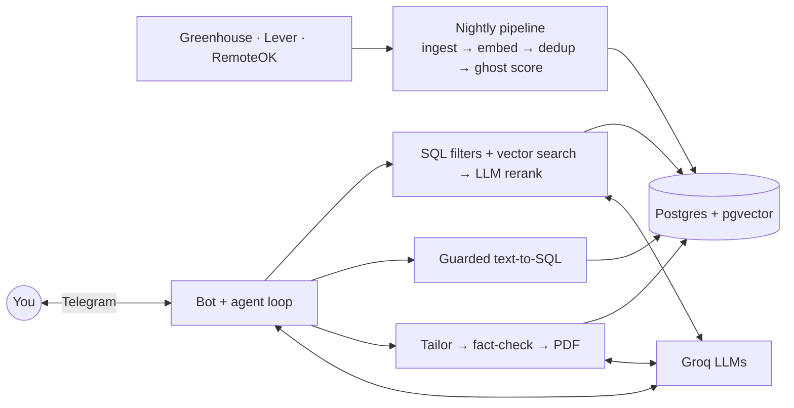

# JobScout, explained from scratch

This document explains the whole project in plain words: what it does, how every piece
works, which technologies we picked and **why**, the problems we ran into while building
it, how we solved them, and what we could have done differently. It's written for someone
starting out — if a word is new, check the [glossary](#14-glossary) at the end.

Every number here was actually measured while building this project, not guessed.

---

## Table of contents

1. [What JobScout does](#1-what-jobscout-does)
2. [The big picture](#2-the-big-picture)
3. [The tech stack — what, why, trade-offs, alternatives](#3-the-tech-stack)
4. [How we built it — phase by phase](#4-how-we-built-it-phase-by-phase)
5. [How the important parts work (step by step)](#5-how-the-important-parts-work)
6. [Problems we hit and how we solved them](#6-problems-we-hit-and-how-we-solved-them)
7. [Testing and evals — how we know it works](#7-testing-and-evals)
8. [Deployment — how it runs on the internet for free](#8-deployment)
9. [Cost and limits](#9-cost-and-limits)
10. [Other ways we could have built it](#10-other-ways-we-could-have-built-it)
11. [Lessons worth remembering](#11-lessons-worth-remembering)
12. [Interview questions you'll probably get](#12-interview-questions-youll-probably-get)
13. [What to build next](#13-what-to-build-next)
14. [Glossary](#14-glossary)

---

## 1. What JobScout does

JobScout is a **job-search assistant that lives inside Telegram**.

1. You open the bot ([@Cosmo122bot](https://t.me/Cosmo122bot)) and answer four questions:
   what role, where, remote or not, minimum salary.
2. You send your resume as a PDF.
3. You type `/jobs`, and it sends you the **3 best real jobs** for you right now. Each one
   comes with a **fit score** (0–100), **reasons** ("your 8 years of Python matches their
   backend work"), and the **biggest gap** ("they want Go, your resume doesn't show it").
4. Under each job there are buttons: 👍, 👎, and **📝 Tailor resume**. Tailor rewrites
   your resume for that specific job — but it is **only allowed to use facts that are
   already in your resume**, and a second check removes anything invented.
5. You can just chat: "no more fintech", "remote only", "how many Python jobs in
   Bangalore were posted this week?". It remembers your preferences.
6. Every morning at 08:00 India time it sends your 3 best **new** matches.

Website: <https://jobscout-6w30.onrender.com> · Code: <https://github.com/boyatomic83/JobSearch>

---

## 2. The big picture

Think of the project as **two halves**:

**Half 1 — collecting jobs (runs every night):**

```
Job websites  →  download  →  clean  →  turn into numbers (embeddings)  →  remove duplicates  →  flag fake/stale jobs  →  database
```

**Half 2 — talking to you (runs whenever you message):**

```
You (Telegram) → bot → AI agent → picks a "tool" (search jobs / save preference / answer a stats question / tailor resume)
                                     → tool uses the database and the AI model → answer back to you
```



**Where things run:**

| Piece | Runs on | Cost |
|---|---|---|
| The app (website + bot backend) | Render (free plan) | $0 |
| The database | Neon (free Postgres) | $0 |
| The nightly job collector + morning digest | GitHub Actions | $0 (public repo) |
| The AI model | Groq (free tier) | $0 |
| The "meaning" model for search (embeddings) | inside our own app, on the CPU | $0 |

---

## 3. The tech stack

For each choice: **what it is**, **why we picked it**, **what we gave up (trade-off)**,
and **what else could work**.

### 3.1 Python + FastAPI (the web server)

- **What:** Python is the language. FastAPI is a library for building web APIs (URLs
  that programs call, like `/health` or `/telegram/webhook`).
- **Why:** Python has the best AI/ML libraries. FastAPI is fast, **async** (it can wait
  on many slow things — AI calls, database — at once without freezing), and it creates
  API docs automatically (`/docs`).
- **Trade-off:** Python is slower than Go or Java for heavy computation. That doesn't
  matter here: our app spends most of its time *waiting* for the AI or database, not
  computing.
- **Alternatives:** Flask (simpler, not async by default), Django (bigger, includes an
  admin panel and ORM — more than we need), Node.js/Express (JavaScript), Go.

### 3.2 Pydantic (data validation)

- **What:** You describe the shape of data as a Python class; Pydantic checks real data
  against it.
- **Why:** AI models sometimes return broken or wrong data. Pydantic catches it. Example:
  our resume profile says `years_experience` must be between 0 and 60 — if the AI says
  99, we reject it instead of storing nonsense.
- **Trade-off:** you write the shapes up front. Worth it.
- **Alternatives:** dataclasses + manual checks, marshmallow, attrs.

### 3.3 PostgreSQL + pgvector (the database)

- **What:** PostgreSQL ("Postgres") is a normal database with tables. **pgvector** is an
  add-on that lets Postgres store **vectors** (lists of numbers that represent meaning)
  and find the most similar ones fast.
- **Why one database for everything:** jobs, users, chat history, preferences, AI logs
  **and** vectors all live together. That means one query can say "find jobs similar to
  this resume **AND** in Bangalore **AND** not from companies you excluded" — the filters
  and the similarity search happen in the same place.
- **Trade-off:** a dedicated vector database can be faster at huge scale (hundreds of
  millions of vectors). At our size (~7,500 jobs) Postgres is more than enough, and we
  avoid running and syncing two databases.
- **Alternatives:** Pinecone, Qdrant, Weaviate, Milvus (dedicated vector DBs);
  Elasticsearch/OpenSearch (great keyword search + vectors); Chroma (simple, local).
- **Neon:** a company that hosts Postgres for free (0.5 GB). Our data uses 97 MB.
  Alternatives: Supabase (also free Postgres + pgvector), AWS RDS (paid).

### 3.4 SQLAlchemy + Alembic (talking to the database)

- **SQLAlchemy** lets us write database queries in Python. We use its **async** mode.
- **Alembic** manages **migrations**: numbered files that change the database structure
  step by step (`0001` creates tables, `0002` adds a salary currency column, ...). Every
  database — your laptop, the tests, production — gets the exact same structure by
  running "upgrade to the latest".
- **Trade-off:** more setup than writing raw SQL strings, but much safer when the schema
  changes over time.
- **Alternatives:** raw SQL with asyncpg, SQLModel, Django ORM, Prisma (JavaScript).

### 3.5 Embeddings: `BAAI/bge-small-en-v1.5` via fastembed

- **What's an embedding?** A model reads text and outputs a list of 384 numbers. Texts
  that **mean** similar things get similar numbers. "Senior Python backend developer"
  and "Backend engineer, Python, 5+ years" end up close together even though the words
  differ. That's how we search by meaning, not just keywords.
- **Why this model:** small (384 numbers per text, ~130 MB), good quality for English,
  runs on a normal CPU, free, no API key, no rate limits.
- **Why fastembed (and not sentence-transformers, which the spec asked for):** see
  [Problem 4](#problem-4-the-embedding-library-didnt-fit-in-memory). Short version: the
  standard library needs PyTorch, which alone used 440 MB of RAM — our server only has
  512 MB. fastembed runs the **same model** using ONNX Runtime (a lighter engine), gives
  **identical** results (we measured), and fits.
- **Trade-off:** a small local model is less accurate than big paid embedding APIs.
- **Alternatives:** OpenAI `text-embedding-3-small` (paid, better), Gemini
  `gemini-embedding-001` (our code supports it as an option), Cohere, `bge-base`/`e5`
  (bigger local models), sentence-transformers (if you have more RAM).

### 3.6 The AI model (LLM): Groq running `gpt-oss-120b` and `gpt-oss-20b`

- **What's an LLM?** A large language model — the "AI" that reads and writes text. We use
  it to read resumes, rank jobs, chat, write SQL, and tailor resumes.
- **Why Groq:** the plan was Google Gemini, but your Google project was blocked from the
  free tier ([Problem 8](#problem-8-gemini-was-blocked)). Groq offers open models free,
  very fast, with an OpenAI-compatible API and tool calling.
- **Why two models:** the bigger `gpt-oss-120b` does careful work (ranking, extraction,
  SQL, tailoring). The smaller, faster `gpt-oss-20b` runs the chat agent. Groq's limits
  are **per model**, so using two models doubles our free budget.
- **Our code is provider-agnostic:** everything goes through a small interface
  (`app/llm/`). Switching to Gemini or xAI is one setting (`LLM_PROVIDER`).
- **Trade-off:** free tiers are slow when busy (limit: 8,000 tokens per minute per
  model) and open models are a bit weaker than the best paid ones.
- **Alternatives:** OpenAI GPT models, Anthropic Claude, Google Gemini (all paid at
  scale), or running a model yourself with Ollama/vLLM (needs a GPU).

### 3.7 Telegram + python-telegram-bot

- **Why a chat bot instead of a website:** no login system to build, works on every
  phone, has push notifications for the morning digest for free, supports files (resume
  PDF in, tailored PDF out) and buttons (👍/👎).
- **Webhook vs polling:** *Polling* = our app asks Telegram "any new messages?" over and
  over (used on a laptop). *Webhook* = Telegram calls our URL whenever there's a message
  (used in production — no wasted requests). The app picks automatically.
- **Trade-off:** users need Telegram; you depend on Telegram's rules.
- **Alternatives:** WhatsApp Business API (paid, approval needed), Slack/Discord bots, a
  web app (more work: login, UI, notifications).

### 3.8 Docker

- **What:** packages the app with everything it needs (Python, libraries, the embedding
  model) into one "image" that runs the same anywhere.
- **Why:** "it works on my machine" problems disappear; Render runs our Dockerfile
  directly. `docker compose up` starts app + database locally with one command.
- **Choices inside:** slim base image (small), runs as a **non-root** user (safer), the
  embedding model is **baked in** so a cold start doesn't download 130 MB.

### 3.9 Smaller tools

| Tool | Job | Why this one | Alternatives |
|---|---|---|---|
| httpx | download job listings | async, timeouts, easy to fake in tests | aiohttp, requests |
| BeautifulSoup | turn job HTML into clean text | forgiving with messy HTML | lxml, html2text |
| pypdf | read text from resume PDFs | pure Python, no system installs | pdfplumber, PyMuPDF |
| reportlab | create the tailored resume PDF | pure Python (weasyprint needs extra system libraries → bigger image) | weasyprint, LaTeX, docx |
| sqlglot | understand AI-written SQL for safety checks | parses SQL into a tree we can inspect | regex (unsafe!), pglast |
| APScheduler | run jobs at set times | simple, in-process | Celery beat, cron |
| GitHub Actions | nightly pipeline, CI, digest | free, has a strong machine, already where the code is | cron-job.org, Render cron jobs (paid) |
| pytest + ruff | tests + code style | standard in Python | unittest, flake8/black |

---

## 4. How we built it, phase by phase

We built in 9 phases, and after **every** phase we: ran the linter (ruff), ran all tests,
committed to git, and tested on real data. Small steps make bugs easy to find.

| Phase | What we built | The key idea |
|---|---|---|
| 1 | Project skeleton, database tables, `/health`, Docker | Get the foundation right: migrations, tests against a real database |
| 2 | Job collectors for Greenhouse, Lever, RemoteOK | Real data from public APIs, polite (rate limits, retries) |
| 3 | Embeddings, duplicate detection, ghost-job score | Turn text into vectors; clean the data |
| 4 | Resume reading + matching (RAG) | Filters in SQL + vector search + AI ranking |
| 5 | The AI agent with tools + memory + safe text-to-SQL | The AI decides which tool to use |
| 6 | Resume tailoring with fact-checking + PDF | Never let the AI invent facts |
| 7 | The Telegram bot + daily digest | The actual product people use |
| 8 | Evals + stats dashboard | Measure quality instead of hoping |
| 9 | Deployment (Render, Neon, GitHub Actions) + docs | Make it live, for free |
| + | Landing page | So recruiters can see it without Telegram |

---

## 5. How the important parts work

### 5.1 Collecting jobs (Phase 2)

Many companies post jobs through **Greenhouse** or **Lever** (hiring software). Both offer
free public APIs that return every open job of a company as JSON. **RemoteOK** offers a
feed of ~100 recent remote jobs.

For each source we wrote a **connector** — a small class with the same `fetch()` method,
so adding a new source means writing one class. Each connector converts the source's
format into one common shape (`JobPosting`: title, company, location, salary, ...).

Being **polite** to these free APIs matters:
- At most one request per second per website.
- If the server says "too many requests" (HTTP 429) or has an error, wait and retry,
  waiting longer each time (**exponential backoff**: 1 s, 2 s, 4 s...).
- If one company's board is broken, log it and continue with the others.

**Saving jobs (upsert):** "insert if new, update if existing". Every job has a
`last_seen_at`. If a job disappears from its board, we mark it inactive. If it comes back
later, we increase `times_reposted` — reposting the same job again and again is a sign of
a fake ("ghost") job.

Result: **~7,500 real jobs from 31 companies in under a minute.**

### 5.2 Turning jobs into vectors (Phase 3)

For each job we build the text to embed: `title + company + first 2000 characters of the
description` — **after removing company boilerplate** (see
[Problem 5](#problem-5-false-duplicates-and-company-boilerplate)). The embedding model
turns that into 384 numbers, stored in the `embedding` column. An **HNSW index** makes
"find the nearest vectors" fast without comparing against every row.

We also store a **content hash** (a fingerprint) of that text. Next night, if the hash
hasn't changed, we skip re-embedding. That turns a 40-minute job into seconds.

### 5.3 Duplicates and ghost jobs (Phase 3)

**Duplicates:** two jobs are the same posting if they have the same company, same
location, same title (ignoring punctuation/case), **and** their embeddings are more than
95% similar. The newer one points to the oldest one (`is_duplicate_of`) and is hidden.

**Ghost score (0 to 1):** a simple, explainable checklist. Each warning sign adds points:

| Warning sign | Points |
|---|---|
| Title like "talent pool", "general application" | 0.50 |
| Posted more than 90 days ago (or 45) | 0.35 (or 0.15) |
| Disappeared and came back (per repost) | 0.15, max 0.30 |
| Very short description | 0.30 |
| No responsibilities/requirements section | 0.10 |
| No salary / no location | 0.05 / 0.10 |

Above 0.7 → hidden. **Why rules and not AI?** Rules are free, instant, and every point
has a written reason we store and can show ("posted 120 days ago (+0.35)"). An AI score
would be a black box. We designed the weights so **one weak signal never hides a job**
— only several together.

### 5.4 Matching: how the 3 jobs are chosen (Phase 4) — this is "RAG"

RAG = **Retrieval-Augmented Generation**: first *retrieve* relevant data from your own
database, then give it to the AI so it *generates* an answer based on real data instead
of its memory.

Step by step, for one user:

1. **Resume → profile.** pypdf extracts text from the PDF. One AI call turns it into a
   structured profile (titles, skills, years, education), checked by Pydantic.
2. **Profile → vector.** We embed "Looking for: Backend Engineer. Senior Backend
   Engineer. 8 years. Skills: Python, FastAPI, ...".
3. **Retrieve top 50 with filters in SQL** — one query that:
   - only keeps active, non-duplicate, non-ghost jobs, never shown to you before;
   - respects location / remote / salary / excluded companies & industries / seniority;
   - sorts the survivors by vector similarity.
4. **Rerank with AI:** the top 20 go to the AI in **one** call. It returns the best 3 with
   a fit score, reasons and a gap. If it returns a job ID that wasn't in the list
   (a "hallucination"), we drop it. If the AI is down, you still get the top 3 by
   similarity, marked "unranked".
5. Save the 3 matches so they're never shown again.

**Why filters in SQL and not "ask the AI to respect preferences"?** Because "remote only"
must **never** be broken. SQL filters are exact and free. The AI is only asked the
fuzzy question it's good at: "which of these fits best, and why?"

**Why only one AI call for ranking?** Free-tier limits. One call with 20 jobs costs about
3,300 tokens; 20 separate calls would cost much more and be slower.

### 5.5 The AI agent (Phase 5)

When you type free text, an **agent** decides what to do. It has **tools** (functions it
can ask us to run):

| Tool | When the AI should use it |
|---|---|
| `search_jobs` | "find me backend jobs" |
| `update_preferences` | "no more fintech", "remote only", "nothing below 40 LPA" |
| `get_preferences` | "what are my settings?" |
| `explain_match` | "why is the first one a good fit?" |
| `tailor_resume` | "tailor my resume for it" |
| `run_sql_readonly` | "how many remote Python jobs are in Bangalore?" |

**The loop (written by hand, no framework):**

```
messages = last 20 chat messages + your new message
repeat (max 6 tool calls):
    ask the AI (with the list of tools)
    if the AI answers with text → done, send it to you
    if the AI asks for a tool → run it, add the result to messages, loop again
if we hit 6 tool calls → ask once more with tools turned off, forcing an answer
```

**Memory comes in two kinds:**
- **Long-term:** your preferences row in the database. It's pasted into the AI's
  instructions on every message, so it always knows them.
- **Short-term:** the last 20 chat messages.

**Why write the loop ourselves instead of LangChain?** It's ~100 lines, we understand
every line, we can log every step, and we can fix problems exactly (we had to — see
Problems 11–13). Frameworks are great for speed but hide what's happening, which is bad
for learning and for an interview.

### 5.6 Safe text-to-SQL (Phase 5)

"How many remote Python jobs in Bangalore this week?" → the AI writes SQL → we run it.
Running AI-written SQL is **dangerous** (what if it writes `DROP TABLE jobs`, or someone
tricks it into reading resumes?). So we use **three independent locks** — any one of them
stops an attack:

1. **Validator:** `sqlglot` parses the SQL into a tree and checks it: exactly one
   `SELECT`; only the `jobs` and `companies` tables; only allowed columns; no `*`; no
   dangerous functions (like reading files); results capped at 100 rows.
2. **Read-only transaction with a 5-second timeout:** even if something slipped through,
   it can't write or run forever.
3. **A restricted database user:** queries run as `jobscout_readonly`, a Postgres role
   that is only *allowed* to read those specific columns. Our tests turn the validator
   off on purpose and show the database itself still refuses to read resumes.

This idea is called **defense in depth**: don't trust one wall.

### 5.7 Resume tailoring without lying (Phase 6)

The biggest risk with AI writing resumes is **invented facts** (a fake employer, a bigger
number). So tailoring has 3 steps:

1. **Rewrite** (AI): reorder and rephrase, using only facts from your resume.
2. **Fact-check** (a second AI call): every sentence, skill and bullet is checked
   against the original. Unsupported → removed.
3. **Rules** (plain code, no AI): any number, skill or company name that doesn't
   literally appear in your original is removed — whatever the AI said.

We tested it with a deliberately bad draft (6 invented claims, 6 true ones). The AI
fact-checker caught **all 6** inventions (including ones with no numbers, like "Mentored
engineers"); the rules caught **4 of 6** on their own; **no true claim was removed**.
Each layer catches things the other misses, so we keep both.

### 5.8 The bot and the daily digest (Phase 7)

The bot code is split in two: `service.py` contains all the logic and returns plain
messages (easy to test without Telegram); `telegram_app.py` only connects Telegram to
that logic. 👎 asks *why*: "not this company" → added to your exclusions automatically;
"other" → you type a reason and the agent updates your preferences.

---

## 6. Problems we hit and how we solved them

This is the most valuable section. Real projects are mostly about problems.

### Problem 1: Docker couldn't download Python packages
- **Symptom:** the Docker build kept timing out connecting to PyPI, but the same download
  worked fine outside Docker.
- **How we found the cause:** tested step by step — `curl` inside a container worked,
  Python inside the default `python:3.12-slim` image failed, the older
  `python:3.12-slim-bookworm` image worked. The newer image uses a newer OpenSSL that
  sends a bigger "hello" message when starting a secure connection, and that got dropped
  on this network.
- **Fix:** use the `bookworm` base image.
- **Lesson:** when something "randomly" fails, change one thing at a time until you find
  the exact difference.

### Problem 2: salary data was garbage in places
- **Symptom:** salaries like "$152,405 – $179,300,152", "$54 – $60" (hourly intern pay),
  "CAD 8,000" (monthly).
- **Fix:** a plausibility check — drop the salary if min > max, max > 10× min, or the
  amount is too small to be yearly. Also store the **currency**, so a ₹40 lakh salary is
  never compared with a $100k one.
- **Why drop instead of guess:** a wrong salary silently breaks the "minimum salary"
  filter. "Unknown" is better than "wrong".

### Problem 3: RemoteOK jobs "disappeared"
- RemoteOK only shows the newest ~100 jobs. A job leaving the feed means "older", not
  "closed". We mark RemoteOK as an *incomplete feed* and never deactivate its jobs for
  disappearing.
- **Lesson:** understand what your data source really means before writing logic on it.

### Problem 4: the embedding library didn't fit in memory
- **Measured:** importing PyTorch + sentence-transformers alone = **440 MB**. Embedding
  peaked at **609 MB** even in tiny batches. Render's free server has **512 MB**. It could
  never work.
- **Options considered:** (a) fastembed — same model, no PyTorch; (b) keep it and pay
  for a bigger server; (c) use a paid embedding API.
- **Check before switching:** we embedded the same texts with both libraries — similarity
  **1.0000**, i.e. identical results. Peak memory dropped to ~410 MB, Docker image from
  2.4 GB to 0.8 GB. You approved the switch.
- **Extra:** setting `MALLOC_ARENA_MAX=2` (a memory setting for multi-threaded programs)
  cut peak memory further (476 → 440 MB on 1,000 jobs).
- **Lesson:** measure memory early, against your real deployment limit.

### Problem 5: false duplicates and company boilerplate
- **Symptom:** the spec's rule "same company + 95% similar = duplicate" flagged **1,504
  jobs (20%)**. Looking at them, **1,452** had different titles: "Senior vs Staff
  Engineer", "Product Designer vs Brand Designer".
- **Root cause:** ~**40%** of all job-description text was company boilerplate ("About
  Stripe...", benefits, equal-opportunity text). Two different jobs at one company
  looked almost identical. In a sample, 60 of 60 different-title pairs scored above 0.95.
- **Fix 1:** remove lines that repeat across many postings of the same company before
  embedding. (A test caught a bug here: with 5 postings, "20% of postings" meant "appears
  once" — so *every* line counted as boilerplate. We added "must appear at least 3 times".)
- **Fix 2:** a duplicate must also have the same title and same location.
- **Result:** 1,504 → **96** duplicates, and the ones we checked were real reposts.
- **Lesson:** don't trust a threshold — look at what it actually flags.

### Problem 6: embedding was too slow for the free server
- **Measured:** ~3 jobs/second on 2 CPUs. Render's free server has 0.1 CPU → the first
  7,500 jobs would take hours.
- **Fix:** do heavy work elsewhere. The nightly pipeline runs on **GitHub Actions**
  (free, powerful machines). For the first load into Neon, we **copied** the vectors we
  had already computed locally (matched by content fingerprint) — 7,458 vectors in
  seconds instead of ~40 minutes.
- **Lesson:** put each job where it fits: a tiny always-on server for chat, a big
  temporary machine for batch work.

### Problem 7: Docker Compose read a comment as a value
- `.env` had `TELEGRAM_WEBHOOK_URL=   # set in production only`. Python's dotenv reads
  that as empty; **Docker Compose reads it as the value "# set in production only"**. The
  app tried to register that as a URL and crashed.
- **Fix:** removed the comment, and the app now checks at startup that the URL is empty
  or starts with `https://` — with a clear error message.
- **Lesson:** different tools parse "the same" config file differently. Validate config.

### Problem 8: Gemini was blocked
- Every Gemini call returned `403: free tier is not available for this project`. Google
  decides this per project; the only official fix is paying.
- **Fix:** because all AI calls go through our own small interface, switching to Groq was
  one new provider class. The Gemini code is still there.
- **Lesson:** never scatter a vendor's library across your code. Wrap it.

### Problem 9: the AI made small mistakes in the first real run
- It put company names and dates inside job titles ("Senior Backend Engineer, Acme
  Payments (2021-present)"), and it **invented** a gap ("GitLab's stack often emphasizes
  Ruby/Go") from its general knowledge, not from the job text.
- **Fix:** clearer prompt rules: titles only; "ground every statement in the text shown;
  never use outside knowledge about a company".
- **Lesson:** always read real outputs, not just "did it return valid JSON".

### Problem 10: "remote" jobs that weren't remote for you
- A "Remote - USA" job was recommended to someone in Bangalore. Then we found **2,074 of
  2,095** remote jobs are restricted to a region. Later, the evals revealed "Remote
  (U.S.)" was treated as worldwide too.
- **Fix:** a remote job only counts if its location mentions one of your locations (e.g.
  "India"), unless it's truly unrestricted ("Remote", "Worldwide").

### Problem 11: "why is the first one a good fit?" pointed at the wrong job
- The AI used a number from the job's URL (8775136002) as the job ID — because our chat
  history only contained the text it showed you (titles and links), not our internal IDs.
  That number was also too big for the database → crash → the bot promised "I'll get
  back to you", which it can't do.
- **Fixes:** chat history now includes a hidden note `[jobs shown: 1) job_id 4080 = ...]`;
  job IDs are range-checked; the prompt says "never promise to follow up later".

### Problem 12: the AI invented things about *you*
- Asked "why is this a good fit?", it said you had "NLP projects" and "GCP" — not on the
  resume. The explain tool only gave it the job, not your profile, so it filled the gap.
- **Fix:** the tool now returns your real profile too, and the prompt forbids claiming
  experience that isn't in it.
- **Lesson:** if the AI doesn't have a fact, it will often make one up. Give it the facts.

### Problem 13: rate limits made the bot slow (60 s per message)
- Groq free tier: **8,000 tokens per minute** per model. One chat turn with a search uses
  ~6–8k tokens. We kept hitting "429 too many requests".
- **What we tried, in order:**
  1. A **token budget** that waits *before* a call instead of failing → no more 429s, but
     still slow.
  2. A **separate model for the agent** (Groq limits are per model → double budget).
     We tried `qwen3.8-27b` (very fast) — but it **made up a statistic** ("1,039 remote
     jobs"; the real number was 2,068) instead of using the SQL tool. Rejected.
     `gpt-oss-20b` used the tools correctly → chosen.
  3. Found a **bug in our own limiter**: we modelled the limit as a fixed 60-second
     window, but providers refill tokens continuously. Switched to a **token bucket**.
  4. Measured that Groq charges ~**500 extra tokens per request** beyond what it reports
     (559 charged for a 93-token call), and accounted for it exactly.
- **Result:** 184 s → **85 s** for a 4-message test with zero errors; a normal first reply
  takes a few seconds. Messages sent back-to-back still wait — that's the free tier.
- **Lesson:** speed isn't one fix; it's measure → change one thing → measure again.

### Problem 14: a missing dependency only showed up in Docker
- `sqlglot` was installed on the laptop but not listed in `pyproject.toml`. All tests
  passed locally; the Docker container crashed on start.
- **Fix:** added it, and a rule: every new library → rebuild Docker before committing.

### Problem 15: boxes in the PDF ("high■performance")
- The AI used a special "non-breaking hyphen" character that the PDF's built-in font
  doesn't have.
- **Fix:** convert text to characters the font supports before drawing.

### Problem 16: a delivery failure lost your jobs forever
- If the morning message failed to send, the 3 jobs were still marked "shown", so you'd
  never see them. A test with a fake "blocked" user caught it.
- **Fix:** if sending fails, those matches are deleted again.

### Problem 17: the evals showed the AI ranking made things *worse*
- For the backend resume, retrieval alone got 3/3 right; with AI reranking only 2/3. The
  AI put a "Senior SRE" job in the top 3 because of shared skills (Kubernetes, AWS) —
  while itself writing "gap: this role is SRE, the resume is backend".
- **Fix:** one rule: "judge the role type first; a different discipline scores below 60".
  After: 3/3.
- **Lesson:** this is exactly why you build evals — it looked fine in demos.

### Problem 18: deployment friction
- The Codespace's GitHub token could push code but not set secrets → you logged in with
  `gh auth login`. GitHub Actions showed 0 workflows until you clicked "enable" on the
  Actions page. Render's URL had a random suffix (`jobscout-6w30`) — we found it from the
  bot's webhook settings. Render's auto-deploy didn't fire once → manual deploy, then a
  deploy hook for the future.
- **Lesson:** deployment always has account/permission surprises; check each step.

---

## 7. Testing and evals

These are two different things:

- **Tests** check the code does what we wrote ("does the SQL guard block `DROP`?").
- **Evals** check how *good* the AI results are ("are the recommended jobs relevant?").

### Tests (174 of them)
- Run with `pytest`, and automatically on every GitHub push (CI).
- **No internet needed.** Job APIs are replaced by **recorded real responses**; the AI is
  replaced by a **fake AI** that returns scripted answers; Telegram by a **fake bot**.
  That makes tests fast, free, and the same every time.
- Database tests use a **real** Postgres with pgvector (in Docker), because faking a
  database hides real bugs.

### Evals
- **Matching:** 3 fictional resumes × real jobs = 76 hand-labelled (resume, job,
  relevant?) pairs. Metrics:
  - **Precision@3** = of the 3 jobs shown, how many are relevant. Result: **0.78**.
  - **Recall@20** = of all relevant jobs, how many made the top 20. Result: **0.91**.
  - The best possible precision with that top 20 was also 0.78 — London has only 1 data
    engineering job in our sources, so it can't do better there.
- **Text-to-SQL:** 15 questions compared against hand-written correct SQL → **13/15**.
  5 malicious SQL inputs + 3 prompt injections → **all blocked**, data untouched.
- **Honesty note:** 3 resumes is small. These numbers catch regressions (they caught two
  real bugs) but are not proof of quality at scale.

---

## 8. Deployment

| What | How |
|---|---|
| Code | GitHub (public repo) |
| App | Render builds the Dockerfile on every push to `main` and runs it |
| Database | Neon (migrations run automatically when the app starts) |
| Bot connection | On startup the app tells Telegram its URL (webhook), protected by a secret header |
| Nightly jobs | GitHub Actions at 02:30 IST: collect → embed → dedup → ghost score, straight into Neon |
| Morning digest | GitHub Actions at 08:00 IST calls `/admin/digest` |
| Staying awake | Render's free server sleeps after 15 idle minutes; GitHub Actions pings it every 10 minutes |
| Secrets | Only in `.env` (never committed), Render's dashboard, and GitHub secrets |

**Why not use the app's own scheduler on Render?** A sleeping server can't run timers.
And doing heavy embedding on 0.1 CPU would take hours. So the in-app scheduler is turned
off in production and GitHub Actions does the timed work.

---

## 9. Cost and limits

At Groq's **paid** prices (on the free tier it's $0):

| Action | Approx. cost |
|---|---|
| Ranking 20 jobs | $0.00074 |
| One chat turn | $0.00014 |
| Tailoring + fact-check | $0.00081 |
| **One active user per day** | **~$0.0035** (≈ $0.10/month) |

Limits on free tiers: ~1,000 AI requests/day per model (roughly 100–200 active users/day),
8,000 tokens/minute (causes waits if you type fast), 512 MB RAM and 0.1 CPU on Render,
0.5 GB on Neon.

---

## 10. Other ways we could have built it

| Instead of... | You could use... | When that's better |
|---|---|---|
| Telegram bot | Next.js/React web app | You want a full UI, accounts, browsing |
| Hand-written agent | LangChain, LlamaIndex, OpenAI Agents SDK, LangGraph | Bigger agents, many tools, faster prototyping |
| pgvector | Qdrant, Pinecone, Weaviate | Millions of vectors, high traffic |
| Rule-based ghost score | A trained classifier | Once you have labelled ghost jobs |
| One rerank call | A cross-encoder model (e.g. `bge-reranker`) | Cheaper, faster, no rate limits — but no written reasons |
| Groq free tier | OpenAI/Claude/Gemini paid | Production reliability and speed |
| Render + GitHub Actions | Fly.io, Railway, Google Cloud Run + Cloud Scheduler | More RAM/CPU, built-in cron |
| Greenhouse/Lever APIs | More ATSs (Ashby, Workable), job aggregator APIs | Better coverage |
| reportlab PDF | Word (.docx) output | Users want to edit the resume |

---

## 11. Lessons worth remembering

1. **Measure, don't guess.** RAM, speed, duplicates, costs — every big decision here came
   from a number.
2. **Read real outputs.** Most AI bugs looked fine until we read the actual text.
3. **Give the AI the facts, and limit what it can do.** Hallucinations mostly happened
   when it lacked information or had too much freedom.
4. **Defense in depth** for anything risky (SQL, resume facts): several independent
   checks.
5. **Do exact things with code, fuzzy things with AI.** Filters, salary checks, number
   checks → code. "Which job fits best?" → AI.
6. **Wrap vendors.** Switching from Gemini to Groq was easy because of one interface.
7. **Small steps + tests + commits.** Every phase ended green and committed, so every bug
   was easy to locate.
8. **Evals catch what demos hide.** The rerank looked great in demos and was measurably
   worse until we fixed it.

---

## 12. Interview questions you'll probably get

**"Why Postgres + pgvector and not Pinecone?"** One database for filters, data and vectors
lets one query combine "similar to my resume" with exact filters. At ~7,500 jobs it's fast
enough, and there's nothing extra to sync.

**"What is RAG here?"** Retrieve the 50 most relevant real jobs from our database (with
filters), then give 20 to the LLM to rank and explain. The LLM only talks about jobs we
gave it, and we drop any job ID it invents.

**"How do you stop the AI from writing dangerous SQL?"** Three layers: a sqlglot validator,
a read-only transaction with a timeout, and a restricted database role. We test the role
with the validator disabled.

**"How do you prevent hallucinated resume content?"** Rewrite, then an LLM fact-check of
every claim, then deterministic rules for numbers, skills and employers. Measured: 6/6
inventions caught, 0 true claims removed.

**"Why didn't you use LangChain?"** The loop is ~100 lines; writing it gave full control
over logging, limits and fixes (like the job-ID problem). I can explain every line.

**"How do you handle rate limits?"** A token bucket that matches the provider's refill
rate, measured per-request overhead, exponential backoff on 429s, response caching, and a
separate model for the agent.

**"What's the weakest part?"** The eval set is small (3 resumes); job coverage is limited
to 31 companies; free-tier latency when messages come fast.

**"What would you change with a budget?"** Paid LLM tier for speed, bigger labelled eval
set, more job sources, learning from 👍/👎 feedback.

---

## 13. What to build next

- A bigger eval set (≈30 resumes, two people labelling) to get trustworthy numbers.
- Learn from 👍/👎: use them to improve ranking.
- More job sources (Ashby, Workable, Indian job boards).
- Smarter ghost detection (how long similar jobs usually stay open).
- Streaming replies so long answers appear word by word.
- Unicode font in PDFs for resumes in other languages.
- A demo GIF in the README.

---

## 14. Glossary

| Term | Meaning |
|---|---|
| **API** | A URL that programs call to get or send data |
| **Async** | Code that can wait for many slow things at once without blocking |
| **Agent** | An AI that decides which tools to call to complete a task |
| **Backoff** | Waiting longer after each failed retry (1 s, 2 s, 4 s...) |
| **CI** | Automatically running tests on every code push |
| **Cosine similarity** | A number (up to 1.0) for how similar two vectors are |
| **Defense in depth** | Several independent safety checks instead of one |
| **Embedding** | A list of numbers representing the meaning of a text |
| **Eval** | A measurement of how good AI outputs are, on labelled examples |
| **Ghost job** | A posting that isn't really hiring (stale, evergreen, reposted) |
| **Hallucination** | When an AI states something false or made up |
| **HNSW** | An index that finds similar vectors quickly |
| **LLM** | Large language model — the text AI |
| **Migration** | A versioned change to the database structure |
| **ONNX Runtime** | A light engine for running ML models without PyTorch |
| **pgvector** | Postgres add-on for storing and searching vectors |
| **Precision@3 / Recall@20** | Share of the top 3 that's relevant / share of relevant jobs found in the top 20 |
| **Prompt** | The instructions and data sent to an LLM |
| **Prompt injection** | Text that tries to trick an AI into ignoring its rules |
| **RAG** | Retrieval-Augmented Generation: fetch real data, then let the AI answer from it |
| **Rate limit / 429** | A provider's cap on requests or tokens; 429 = "too many requests" |
| **Rerank** | Re-ordering search results with a smarter (slower) model |
| **Token** | A chunk of text (~4 characters) that LLMs read and bill by |
| **Token bucket** | A rate limiter that refills a budget continuously |
| **Tool calling** | The LLM asking your code to run a function with given arguments |
| **Upsert** | Insert if new, update if it already exists |
| **Webhook** | A service calls your URL when something happens (vs you asking repeatedly) |
